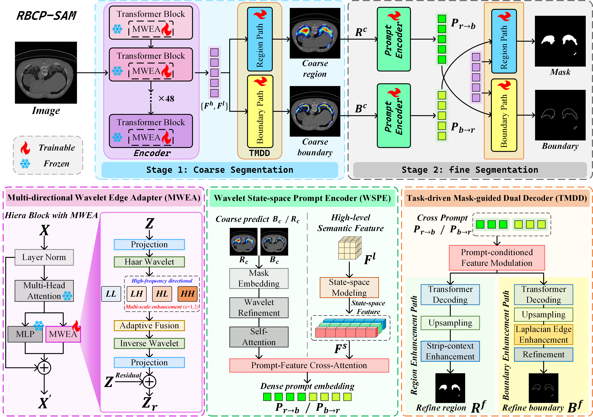
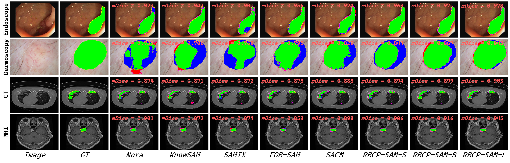
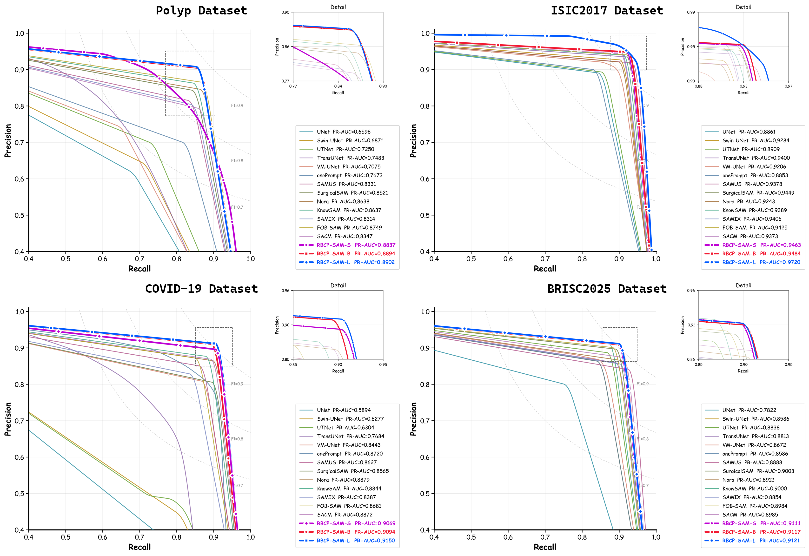
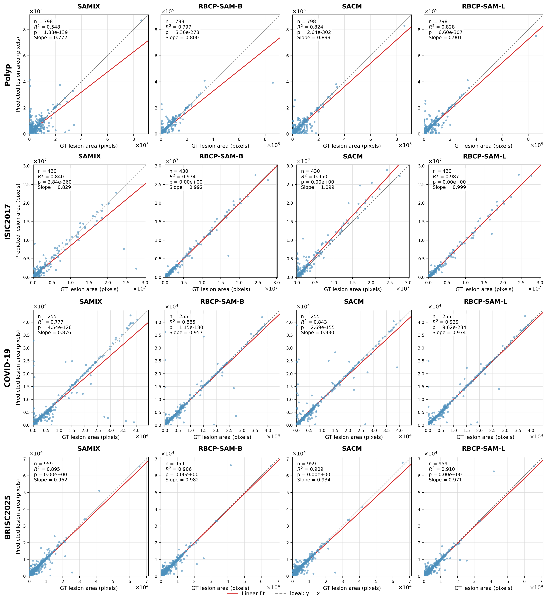
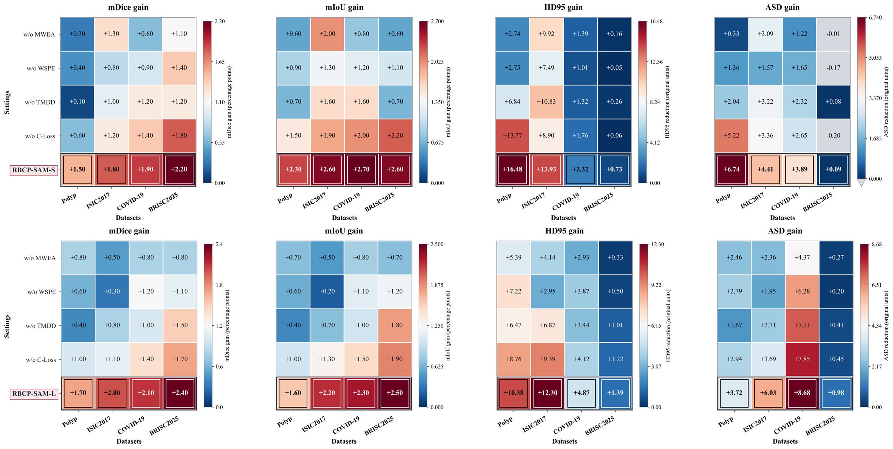

# RBCP-SAM: Bidirectional Collaborative Prompting with SAM for Medical Image Segmentation

> **Publication status and code availability (November 2026).** This manuscript is currently in the **journal submission and peer-review process**. During this period, we are releasing **figures, model prediction results, model weights, and selected portions of the code only**. The **complete source code**, including the full training and inference implementations, **will be released after the manuscript is accepted**. We appreciate your interest and patience.

**RBCP-SAM** is a **region–boundary collaborative prompting framework based on SAM2.1** for **automatic medical image segmentation**. Medical image segmentation remains challenging because of low image contrast, blurred boundaries, and irregular lesion shapes. Although the Segment Anything Model (SAM) provides a flexible prompt-driven segmentation paradigm, its performance is sensitive to the quality of the input prompts. The central idea of RBCP-SAM is to transform intermediate region and boundary predictions into **mutually guiding structured prompts**: coarse boundaries provide geometric guidance for refining lesion regions, while coarse regions provide semantic guidance for refining lesion boundaries. RBCP-SAM produces segmentation masks **without manual prompts or additional localization networks**.

This repository accompanies the manuscript:

**Ya-Kun Qiao, Guang-Hai Liu, Zhihui Lai, Xiao-Peng Li, and Bo-Jian Zhang.**  
*Bidirectional Collaborative Prompting with SAM for Medical Image Segmentation.*  
**Manuscript under review, 2026.**

## Contents

- [Method](#method)
- [Experimental Results](#experimental-results)
- [Datasets and Download Links](#datasets-and-download-links)
- [Implementation Details](#implementation-details)
- [Prediction Results and Model Weights](#prediction-results-and-model-weights)
- [Getting Started](#getting-started)
- [Citation](#citation)
- [Acknowledgments and Contact](#acknowledgments-and-contact)

## Method

RBCP-SAM adopts a **two-stage, coarse-to-fine** strategy built on frozen SAM2.1 image encoders:

1. **Coarse prediction:** the region and boundary branches produce coarse masks `R^c` and `B^c`;
2. **Collaborative prompting and refinement:** each coarse prediction is encoded as a structured prompt for the complementary task — `B^c → P_b→r → R^f` (boundary-to-region guidance) and `R^c → P_r→b → B^f` (region-to-boundary guidance).

All structured prompts are generated from model predictions, **without user-supplied points, boxes, or an external localization network**. The framework integrates three key methods, and training additionally uses a **region–boundary consistency loss (C-Loss)**:

| Component | Main function |
|:-----------|:--------------|
| **MWEA** (Multi-directional Wavelet Edge Adapter) | Enhances boundary representations using Haar wavelet decomposition and learnable multi-directional operators in the image encoder. |
| **WSPE** (Wavelet-guided State-space Prompt Encoder) | Encodes coarse predictions into informative prompts by combining wavelet-based structural enhancement with state-space context modeling. |
| **TMDD** (Task-driven Mask-guided Dual Decoder) | Refines region and boundary predictions through cross-prompt feature modulation and task-specific decoding. |

### Overall framework



*Overview of the proposed RBCP-SAM framework and its key methods (MWEA, WSPE, and TMDD). The SAM2.1 image encoder is frozen; MWEA, the prompt encoder, and the mask decoder are trainable.*

## Experimental Results

RBCP-SAM was evaluated on **five within-dataset benchmarks** and **four cross-dataset generalization settings**. mDice and mIoU measure lesion-region overlap (higher is better); HD95 and ASD measure boundary discrepancies in pixels (lower is better). Within-dataset rows below correspond to **RBCP-SAM-L**.

| Dataset | Modality | mDice ↑ | mIoU ↑ | HD95 ↓ | ASD ↓ |
|:--------|:---------|--------:|-------:|-------:|------:|
| Polyp | Endoscopy | **0.854** | **0.788** | **53.81** | **23.33** |
| ISIC2017 | Dermoscopy | **0.926** | **0.867** | **80.01** | **31.08** |
| ISIC2018 | Dermoscopy | **0.915** | **0.857** | **117.38** | **46.64** |
| COVID-19 | Lung CT | **0.820** | **0.742** | **33.75** | **11.93** |
| BRISC2025 | Brain MRI | **0.901** | **0.840** | **10.67** | **3.03** |

### mDice comparison with state-of-the-art methods

Model complexity (Years, Params, # Params) is from Table 1 of the manuscript; mDice scores are test-set results across the five benchmarks (Tables 1–3). "Params" denotes total parameters and "# Params" denotes trainable parameters. The best mDice in each column is shown in bold.

| Method | Years | Params (M) | # Params (M) | Polyp | ISIC2017 | ISIC2018 | COVID-19 | BRISC2025 |
|:-------|------:|-----------:|-------------:|------:|---------:|---------:|---------:|----------:|
| UNet | 2015 | 28.96 | 28.96 | 0.662 | 0.885 | 0.878 | 0.700 | 0.865 |
| Swin-UNet | 2021 | 27.15 | 27.15 | 0.775 | 0.889 | 0.885 | 0.763 | 0.849 |
| UTNet | 2021 | 14.14 | 14.14 | 0.734 | 0.860 | 0.862 | 0.757 | 0.866 |
| TransUNet | 2024 | 96.23 | 96.23 | 0.784 | 0.905 | 0.895 | 0.747 | 0.848 |
| VM-UNet | 2024 | 27.43 | 27.43 | 0.783 | 0.873 | 0.879 | 0.555 | 0.836 |
| OnePrompt | 2024 | 124.94 | 36.08 | 0.664 | 0.859 | 0.869 | 0.751 | 0.830 |
| SAMUS | 2024 | 133.30 | 39.70 | 0.787 | 0.913 | 0.900 | 0.788 | 0.861 |
| SurgicalSAM | 2024 | 641.68 | 4.65 | 0.679 | 0.865 | 0.850 | 0.555 | 0.778 |
| Nora | 2025 | 94.09 | 7.41 | 0.802 | 0.908 | 0.901 | 0.759 | 0.863 |
| KnowSAM | 2025 | 120.90 | 27.26 | 0.620 | 0.905 | 0.900 | 0.698 | 0.877 |
| SAMIX | 2026 | 91.40 | 26.90 | 0.821 | 0.911 | 0.890 | 0.775 | 0.858 |
| FOB-SAM | 2026 | 691.30 | 54.60 | 0.827 | 0.901 | 0.901 | 0.761 | 0.869 |
| SACM | 2026 | 325.29 | 17.01 | 0.816 | 0.907 | 0.901 | 0.793 | 0.865 |
| RBCP-SAM-S | - | 48.66 | 14.71 | 0.835 | 0.920 | 0.911 | 0.814 | 0.891 |
| RBCP-SAM-B | - | 86.16 | 17.48 | 0.844 | 0.923 | 0.911 | 0.816 | 0.894 |
| **RBCP-SAM-L** | - | 240.89 | 28.75 | **0.854** | **0.926** | **0.915** | **0.820** | **0.901** |

Compared with SACM, RBCP-SAM-L improves mDice by 4.66%, 2.09%, and 3.40% on Polyp, ISIC2017, and COVID-19, respectively; compared with the much larger FOB-SAM (691.30 M), it uses only 34.85% of the total parameters while achieving better performance.

### Qualitative segmentation comparison



*Visual comparison of lesion segmentation results across different medical imaging modalities, where green, red, and blue indicate true positives (TP), false positives (FP), and false negatives (FN), respectively.*

### P-R curve comparison



*Precision–Recall curves of different segmentation methods on the Polyp, ISIC2017, COVID-19, and BRISC2025 datasets.*

### Lesion-area regression analysis



*Linear regression analysis of predicted and ground-truth lesion areas across four medical image datasets, evaluating the consistency of lesion-area estimation.*

### Cross-dataset generalization

Results of **RBCP-SAM-L** on unseen target datasets **without additional target-domain adaptation**.

| Transfer setting | Task | mDice ↑ | mIoU ↑ | HD95 ↓ | ASD ↓ |
|:-----------------|:-----|--------:|-------:|-------:|------:|
| SZ → MON | Chest X-ray lung field | **0.969** | **0.940** | **78.11** | **20.28** |
| SZ → JSRT | Chest X-ray lung field | **0.977** | **0.951** | **6.74** | **2.09** |
| BUSI → DatasetB | Breast ultrasound | **0.853** | **0.776** | **11.88** | **2.58** |
| BUSI → STU | Breast ultrasound | **0.893** | **0.815** | **5.38** | **2.66** |

### Ablation analysis



*Performance gains of the full RBCP-SAM over ablated variants (w/o MWEA, WSPE, TMDD, or C-Loss) on four benchmark datasets. The upper and lower rows correspond to RBCP-SAM-S and RBCP-SAM-L, respectively.*

**Further analyses** (stability over repeated runs) are reported in the manuscript.

## Datasets and Download Links

**All datasets belong to their respective providers and are not redistributed in this repository.** Please obtain them from the original sources and cite their dataset papers.

- **Polyp** (1,450 training: 900 Kvasir-SEG + 550 CVC-ClinicDB; 798 testing: 60 CVC-300 + 62 CVC-ClinicDB + 380 CVC-ColonDB + 196 ETIS + 100 Kvasir-SEG): [Kvasir-SEG](https://datasets.simula.no/kvasir-seg/), [CVC-ClinicDB](https://polyp.grand-challenge.org/CVCClinicDB/), [CVC-300](http://adas.cvc.uab.es/endoscene/), [CVC-ColonDB](https://pages.cvc.uab.es/CVC-Colon/index.php/databases/), [ETIS](https://polyp.grand-challenge.org/EtisLarib/); the same partition is available via the [PraNet benchmark split](https://github.com/DengPingFan/PraNet).
- **ISIC2017** (2,150 images): [ISIC Challenge — 2017](https://challenge.isic-archive.com/data/#2017). **ISIC2018** (2,694 images): [ISIC Challenge — 2018](https://challenge.isic-archive.com/data/#2018). Both are divided into training/validation/test at **7:1:2** in the manuscript.
- **COVID-19** (1,277 chest CT images): [Inf-Net resources](https://github.com/DengPingFan/Inf-Net) and [COVID-19 CT Segmentation dataset](https://medicalsegmentation.com/covid19/).
- **BRISC2025** (4,793 annotated T1-weighted brain MRI images of 6,000): [BRISC2025 on Kaggle](https://www.kaggle.com/datasets/briscdataset/brisc2025/).
- **Cross-dataset sources:** [Shenzhen / Montgomery (NLM)](https://lhncbc.nlm.nih.gov/publication/pub9231/) (556 / 138 images), [JSRT](http://db.jsrt.or.jp/eng.php) (247 images), [BUSI](https://scholar.cu.edu.eg/?q=afahmy/pages/dataset) (647 lesion-containing images); DatasetB (163) and STU (42) are obtained from the publications cited in the manuscript. Source datasets are split 8:2 into training/validation.

## Implementation Details

The pretrained SAM2.1 backbones are **frozen**; MWEA, the prompt encoder, and the mask decoder are **trained**.

| Model | Backbone | Params (M) | # Params (M, trainable) |
|:------|:---------|-----------:|------------------------:|
| RBCP-SAM-S | Hiera-S | 48.66 | 14.71 |
| RBCP-SAM-B | Hiera-B | 86.16 | 17.48 |
| RBCP-SAM-L | Hiera-L | 240.89 | 28.75 |

- **Input resolution:** 1024 × 1024; **batch size:** 2.
- **Optimization:** AdamW; initial learning rate `1e-4`; weight decay `1e-4`; up to 80 epochs.
- **Augmentation:** random flipping, rotation, and photometric augmentation; mixed-precision training.
- **Loss:** region and boundary supervision combined with the region–boundary consistency loss (C-Loss).
- **Environment:** PyTorch 2.4.0, CUDA 12.2, NVIDIA GeForce RTX 3090. Inference is fully automatic; no manual prompts are required.

## Prediction Results and Model Weights

Download links are provided via **Google Drive** and **Baidu Netdisk**, and will be filled in upon release. Place the downloaded prediction results and model weights under the `prediction_result` and `weights` directories, respectively, to evaluate the RBCP-SAM results.

### Prediction results

| Dataset | Google Drive | Baidu |
|:--------|:-------------|:------|
| Polyp | [Download](https://drive.google.com/drive/folders/1MxzsBkY_9oWf0dFem-Py19GRCawssFgM?usp=drive_link) | [Download](https://pan.baidu.com/s/10uqLdzObpM2mM65E4VioWw?pwd=kkhx) |
| ISIC2017 | [Download](https://drive.google.com/drive/folders/16MS3bVnV6QvIvNV4mQxImOh-GRtxfBni?usp=drive_link) | [Download](https://pan.baidu.com/s/1Lt6Y2ot06F2WpVO0cPaiIw?pwd=nm21) |
| ISIC2018 | [Download](https://drive.google.com/drive/folders/1IjpUDAKi0FVyZMVU8nhPsdrk_ogWv6XQ?usp=drive_link) | [Download](https://pan.baidu.com/s/1q2Wf-yGoQiTE4nJhtsIegQ?pwd=8794) |
| COVID-19 | [Download](https://drive.google.com/drive/folders/1ywbbxpZ_O1w0ZfC8trtXm6yMXCbbCOnx?usp=drive_link) | [Download](https://pan.baidu.com/s/1MkneTy2uUKUqenWOKG2lvA?pwd=9jym) |
| BRISC2025 | [Download](https://drive.google.com/drive/folders/1iMz6YX4KNILQdgIYGW0CABXmQisSM8jO?usp=drive_link) | [Download](https://pan.baidu.com/s/19tkqFeCtk6XVAe8gsvJPiA?pwd=hjnm) |

### Model weights

| Dataset | Google Drive | Baidu |
|:--------|:-------------|:------|
| Polyp | [best.pth](https://drive.google.com/drive/folders/1vX0IFF4qZoyqIKfht1j7l3WVNbvNxTBU?usp=drive_link) | [best.pth](https://pan.baidu.com/s/188cLn67Qc5XKyWgCtoqdxA?pwd=6vza) |
| ISIC2017 | [best.pth](https://drive.google.com/drive/folders/1Q4LEMUefYnCB1KJBdXhBOlSsvNz8vwUm?usp=drive_link) | [best.pth](https://pan.baidu.com/s/1Z3-UAWnF8CK6xt1tkC2-3w?pwd=7j4n) |
| ISIC2018 | [best.pth](https://drive.google.com/drive/folders/1iJzkBYYt67EaxvfnuTCY26eaa7IZS7UW?usp=drive_link) | [best.pth](https://pan.baidu.com/s/1xq1ka5jt48-Vans0JBIe5Q?pwd=d2xr) |
| COVID-19 | [best.pth](https://drive.google.com/drive/folders/1l-gdeKdyezVkeGwnSLs-NXmiYlpSJ4sV?usp=drive_link) | [best.pth](https://pan.baidu.com/s/1ltbSqHRjxY-zFXFlRY3ptg?pwd=y4w9) |
| BRISC2025 | [best.pth](https://drive.google.com/drive/folders/1_6MRuESdWJ9MHKGo8ftGVGUUJvk4Mdt7?usp=drive_link) | [best.pth](https://pan.baidu.com/s/1H4xpmTLTgzyBrlxL1JQvwA?pwd=e4nb) |

## Getting Started

### 1. Environment

RBCP-SAM builds upon **SAM2.1**. Create the environment from the provided specification:

```bash
conda env create -f environment.yaml
conda activate sam2
```

Refer to the official [SAM 2 repository](https://github.com/facebookresearch/sam2) for additional SAM2 build instructions.

### 2. Model preparation

Download the official **SAM2.1** pretrained backbones from the [SAM 2 repository](https://github.com/facebookresearch/sam2) and place them in a `preTrain/` folder at the repository root:

```
preTrain/
├── sam2.1_hiera_large.pt      # default (--sam-model large)
├── sam2.1_hiera_base_plus.pt  # optional
├── sam2.1_hiera_small.pt      # optional
└── sam2.1_hiera_tiny.pt       # optional
```

### 3. Data preparation

The `data/` folder is **not included** in this repository — please create it yourself at the repository root and download the required datasets into it with the following layout:

```
data/
├── polypImg/                      # within-dataset: PraNet benchmark split
│   ├── TrainDataset/images|masks
│   └── TestDataset/{CVC-300, CVC-ClinicDB, CVC-ColonDB, ETIS-LaribPolypDB, Kvasir}/images|masks
├── ISIC2017/images|masks          # within-dataset: single image/mask pools
├── ISIC2018/images|masks
├── COVID-19/images|masks
├── BRISC2025/images|masks
├── Shenzhen/images|masks          # cross-dataset sources and targets
├── Montgomery/images|masks
├── JSRT/images|masks
├── BUSI/images|masks
├── DatasetB/images|masks
└── STU/images|masks
```

**Split and model-selection protocol**

- **Polyp** uses the official PraNet-style partition (1,450 training / 798 testing). During training, `best.pth` is selected by the **minimum epoch training loss**; the five official test subsets are evaluated afterwards with `eval_lesion.py`.
- **ISIC2017 / ISIC2018 / COVID-19 / BRISC2025** are single image/mask pools that the code automatically splits into training/validation/test at a ratio of **7:1:2** (deterministic; `--split-seed`, default 42). `best.pth` is selected by the **maximum validation mDice**, and the held-out test split is evaluated with `eval_lesion.py`.
- ISIC2017/ISIC2018 masks keep the official `_segmentation` suffix; image/mask pairing is resolved automatically.
- Verify your layout at any time with `python train_lesion.py --list-datasets`.

### 4. Within-dataset training and evaluation

```bash
# Training (RBCP-SAM-L by default; --sam-model small|base_plus|large)
python train_lesion.py --dataset polypImg
python train_lesion.py --dataset ISIC2017

# Evaluation on the test split/subsets (writes metrics and predicted masks)
python eval_lesion.py --dataset polypImg
python eval_lesion.py --dataset ISIC2017

# Standalone image-wise evaluation of saved masks with the manuscript
# metrics (mDice, mIoU, HD95, ASD); no GPU required
python evaluate_metrics.py --dataset ISIC2017 --pred-dir results_lesion/ISIC2017/test/region_masks
python evaluate_metrics.py --dataset polypImg --pred-dir results_lesion/polypImg
```

### 5. Cross-dataset training and evaluation

```bash
# 8:2 train/validation split of the source dataset; the target is never
# seen during training or model selection
python train_cross.py --source shenzhen --target montgomery
python test_cross.py  --source shenzhen --target montgomery

python train_cross.py --source busi --target datasetb
python test_cross.py  --source busi --target datasetb
```

Checkpoints are saved to `outputs_lesion/<dataset>/best.pth` and `outputs_cross/<source>_to_<target>/best.pth`; evaluation results and predicted masks are written to `results_lesion/` and `results_cross/`.

## Citation

If you use the currently released materials, please acknowledge this work. **The entry below is temporary** and will be replaced with the final bibliographic citation after publication.

```bibtex
@misc{qiao2026rbcpsam,
  title  = {Bidirectional Collaborative Prompting with SAM for Medical Image Segmentation},
  author = {Qiao, Ya-Kun and Liu, Guang-Hai and Lai, Zhihui and Li, Xiao-Peng and Zhang, Bo-Jian},
  year   = {2026},
  note   = {Manuscript under submission and review}
}
```

Please also cite the **original publications of any datasets** used in your experiments.

## Acknowledgments and Contact

RBCP-SAM builds upon [SAM 2](https://github.com/facebookresearch/sam2). We thank the authors of SAM 2 and the creators of the publicly available medical imaging datasets used in the experiments.

**Corresponding author:** Ya-Kun Qiao  
**E-mail:** [yakun_qiao2019@163.com](mailto:yakun_qiao2019@163.com)
